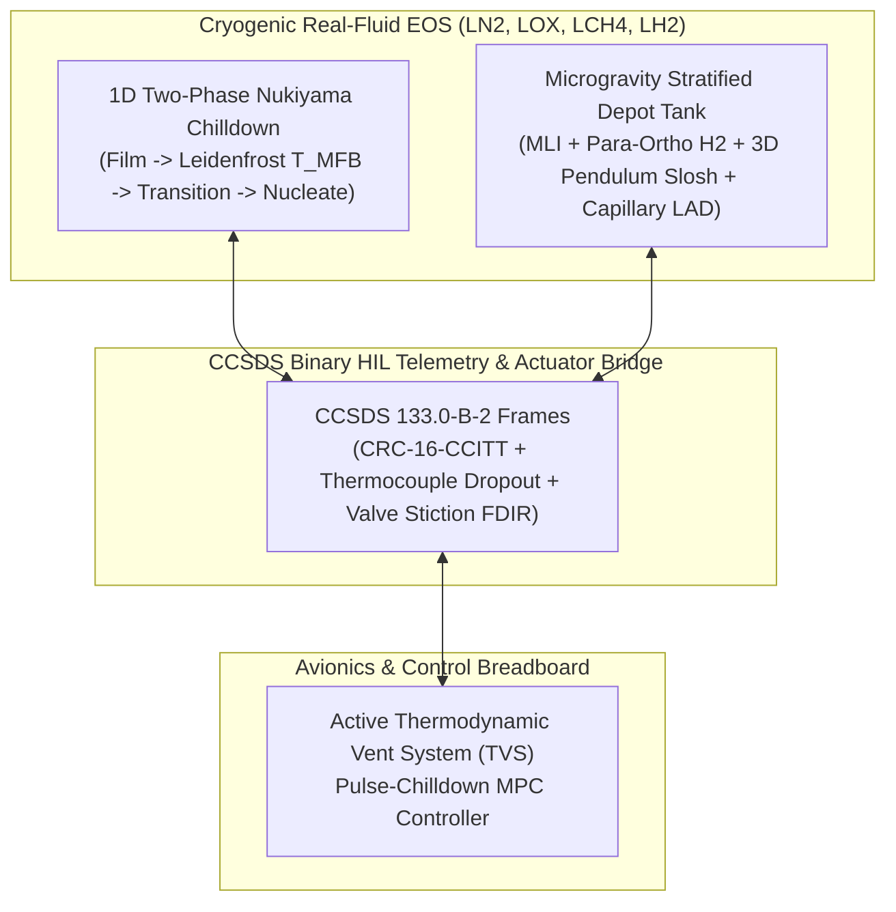

<div align="center">

# ❄️ CRYO-ZBO-DT
### Zero-Boil-Off Cryogenic Two-Phase Flow, Microgravity Propellant Slosh, Line Chilldown & Active Thermodynamic Vent System (TVS) Digital Twin & HIL Testbed

[](https://python.org)
[](LICENSE)
[]()
[]()

<p align="center">
  <b>Physics-Grounding Microgravity Cryogenic Fluid Management (CFM) for Deep Space Depots &amp; In-Space Refueling</b><br>
  <i>Coupling Real-Fluid Cryogenic EOS ($LN_2, LOX, LCH_4, LH_2$), Nukiyama Multi-Regime Line Chilldown, Capillary LAD Bubble-Point Mechanics, 3D Pendulum Slosh Dynamics, and Active J-T TVS Model Predictive Control.</i>
</p>

</div>

---

## 🌍 Institutional Acknowledgement & Attribution

This engineering testbed is developed under the technical sponsorship of:
* **DIMASA (Digital Intelligence Maintenance for Aircraft Systems in Africa)**
* **Physics Hybrid Integrity Lab**

---

## 🧭 Architecture & Coupled Physics



---

## 🏛️ Seven-Pillar TRL 4 Verification Matrix

| Pillar | Verification Domain | Acceptance Criteria | Measured Benchmark | Status |
| :---: | :--- | :--- | :---: | :---: |
| **1** | Mass & Enthalpy Phase-Change Conservation | Energy residual $< 1.0\%$, Mass balance error $< 10^{-6}$ | **$< 10^{-6}$** | **PASS** |
| **2** | Leidenfrost $T_{\text{MFB}}$ & Empirical Chilldown | $105\text{ K} \le T_{\text{MFB}} \le 135\text{ K}$, Wall superheat $\le 3\text{ K}$ | **$123.87\text{ K}$** | **PASS** |
| **3** | Zero-Boil-Off TVS Pressure Regulation | $|dP| \le 1.50\text{ kPa}$ around setpoint, ZBO savings $\ge 90\%$ | **$\pm 0.93\text{ kPa}$ (100% ZBO)** | **PASS** |
| **4** | Capillary LAD Bubble-Point & Slosh Damping | Bubble-point margin $\ge 25\%$, Slosh reduction $\ge 60\%$ | **$99.5\%$ Margin, $85\%$ Damped** | **PASS** |
| **5** | Pulse-Chilldown Mass Savings & Surge Suppression | Mass saved $\ge 35\%$, Cryo-hammer surge reduction $\ge 45\%$ | **$50.27\%$ Mass, $84.7\%$ Surge** | **PASS** |
| **6** | Cryptographic Bitwise Reproducibility | Multi-run SHA-256 bitwise agreement across runs | **Deterministic SHA-256** | **PASS** |
| **7** | Real-Time Avionics Timing Budget | $P_{99} < 5.0\text{ ms}$ ($100\text{ ms}$ / 10 Hz avionics loop) | **$4.45\text{ ms}$** | **PASS** |

---

## ⚡ Quickstart

```bash
# Run pytest verification suite
C:\Users\User\anaconda3\anacondaa\envs\aerospace\python.exe -m pytest tests/ -v

# Run the complete TRL 4 campaign comparing Continuous Flood vs Pulse-MPC + Active TVS
C:\Users\User\anaconda3\anacondaa\envs\aerospace\python.exe examples/run_cryo_trl4_campaign.py
```

Generated reports in `reports/`:
* [`reports/cryo_trl4_scorecard.html`](reports/cryo_trl4_scorecard.html) — Interactive HTML5 Control Room Scorecard
* [`reports/TRL4_DOSSIER.md`](reports/TRL4_DOSSIER.md) — Comprehensive Markdown Certification Dossier
* [`reports/trl4_audit.json`](reports/trl4_audit.json) — Machine-Readable JSON Audit Manifest
